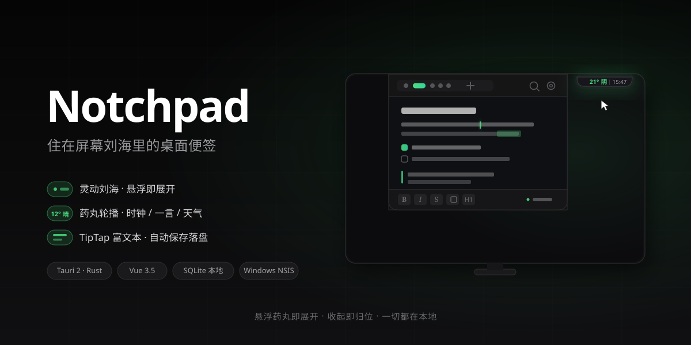
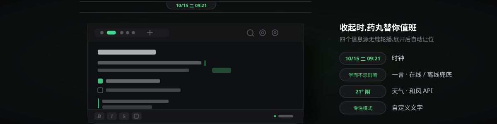

<div align="center">

# Notchpad

**一款住在屏幕刘海里的桌面便签**

Tauri 2 + Rust + Vue 3 + TipTap

[](https://github.com/TIUCSIB/notchpad/releases)
[](LICENSE)
[](https://tauri.app/)
[](https://vuejs.org/)
[](https://www.typescriptlang.org/)

[下载安装包](https://github.com/TIUCSIB/notchpad/releases) · [快速开始](#-快速开始) · [功能总览](#-功能亮点)

</div>

---

> 紧贴屏幕顶部的智能便签：平时收成刘海下的一颗小药丸，悬浮即展开，随时记下想法。所有数据都在本地。

---

## ✨ 功能亮点

### 🌧️ 灵动刘海交互

应用启动后自动收起为屏幕顶部中央的小药丸（顶部齐平、底部圆润的刘海造型），悬浮或点击即可展开完整编辑区域，收回时带弹性弹簧动画。

- **悬浮唤醒**：鼠标经过药丸时自动展开
- **点击唤醒**：点击药丸展开，带 Jelly 弹跳动效
- **全局快捷键**：`Ctrl+Alt+Z` 随时呼出窗口并展开
- **多显示器**：窗口可在多个显示器间切换，选择自动持久化
- **单实例**：二次启动自动唤起已有窗口，不会重复开进程

### 🎞️ 药丸轮播：收起时也在工作



收起状态下，药丸在四个信息源之间无缝轮播，展开后自动让位给编辑器：

| 来源 | 内容 | 说明 |
| --- | --- | --- |
| 时钟 | `10/15 二 09:21` | 月日 + 星期单字 + 时间 |
| 一言 | 每次一句 | [hitokoto](https://hitokoto.cn/) 在线 API,可按分类筛选;离线自动兜底为本地语录 |
| 天气 | `21° 阴` | [和风天气](https://dev.qweather.com/),填入开发者 Key 与城市名即可,支持自定义 API Host |
| 自定义 | 任意文字 | 设置里自己填 |

一言与天气的更新频率均可调（5 分钟 ~ 每天 / 每次收起时），网络失败静默回落，不影响其他轮播项。

### 📝 富文本编辑器

基于 [TipTap](https://tiptap.dev/) 构建：

| 功能 | 描述 |
| --- | --- |
| 文本格式 | 加粗、斜体、删除线、行内代码 |
| 结构化 | 引用块、有序/无序列表、任务列表 |
| 链接 | 插入链接，左键/右键直接在系统浏览器打开 |
| 图片 | 截图直接粘贴，自动压缩至 1920px 宽度（JPEG 质量 0.8） |
| 字体 | 字号（12-32px）、颜色、高亮、字体样式 |
| 其他 | 分割线、实时字数统计 |

### 📄 多页面管理

页面数上限可调（默认 **10** 页，设置中可在 3~30 之间调整），顶部胶囊状导航栏切换：

- 拖拽排序，动画平滑无抖动
- 双击圆点编辑页面标题，悬浮显示 Tooltip
- 支持页面置顶/取消置顶
- **跨页搜索**：`Ctrl+F` 唤起全局搜索面板，按标题/正文匹配所有页面
- **回收站**：删除的页面保留 24 小时，错过 5 秒撤销 toast 也能一键恢复

### 💾 数据持久化

SQLite（rusqlite 原生绑定）本地存储，每条修改即时落盘，数据保存在 `userData/memo.db`。粘贴的图片以文件形式存放在数据库旁的 `attachments/` 目录，不拖累数据库体积。支持自定义存储位置，可在设置中将数据库连同图片一并迁移到其他目录。

### 🔄 应用内更新

设置页一键检查更新，发现新版本自动下载并重启升级（更新包经 minisign 签名校验），不必手动盯 Releases。

### 🔵 系统托盘

关闭窗口后应用驻留系统托盘，双击托盘图标即可恢复，右键菜单提供显示窗口和退出选项。

### ⚙️ 设置中心

- **主题**：深色 / 浅色 / 跟随系统
- **强调色**：7 种预设颜色
- **默认字号**：12px - 32px
- **唤醒方式**：悬浮展开 / 点击展开
- **开机自启**：一键开关
- **页面数上限**：3 - 30 页
- **存储位置**：自定义数据库存储目录
- **数据导入/导出**：JSON 和 Markdown 格式备份与恢复

编辑内容后自动保存，底部显示"保存中"/"已保存"状态指示器，也可用 `Ctrl+S` 手动保存。

---

## 🔢 快捷键速查

| 快捷键 | 功能 | 快捷键 | 功能 |
| --- | --- | --- | --- |
| `Ctrl+N` | 新建页面 | `Ctrl+Z` | 撤销 |
| `Ctrl+D` | 删除页面 | `Ctrl+Y` | 重做 |
| `Ctrl+S` | 保存 | `Ctrl+W` | 最小化到托盘 |
| `Ctrl+F` | 跨页搜索 | `Ctrl+Shift+M` | 切换显示器 |
| `Ctrl+Tab` | 下一页 | `Ctrl+Shift+Tab` | 上一页 |
| `Ctrl+1~9` | 跳转页面 | `Ctrl+Alt+Z` | 全局呼出窗口 |

---

## 📦 技术栈

| 类别 | 技术 |
| --- | --- |
| 框架 | Tauri 2 (Rust 后端) + Vue 3.5 |
| 构建 | Vite 7 + Tauri 2 CLI |
| 编辑器 | TipTap 3 (StarterKit + 扩展) |
| 动画 | motion-v（弹性物理动画） |
| 图标 | Lucide Vue Next |
| 数据库 | rusqlite (原生 SQLite) |
| 测试 | Vitest + jsdom(前端)/ cargo test(Rust 集成测试) |
| 语言 | TypeScript |
| 包管理 | pnpm |

---

## 🚀 快速开始

### 环境要求

- Node.js >= 18
- pnpm >= 8
- Rust (MSVC 工具链,Windows)

### 安装与运行

```bash
# 克隆仓库
git clone https://github.com/TIUCSIB/notchpad.git
cd notchpad

# 安装依赖
pnpm install

# 开发模式
pnpm tauri:dev

# 构建 Windows 安装包(约 3-4MB)
pnpm tauri:build
```

不想自己构建?直接到 [Releases](https://github.com/TIUCSIB/notchpad/releases) 下载 NSIS 安装包。

<details>
<summary><strong>📂 项目结构</strong></summary>

```
src-tauri/                        # Tauri 2 Rust 后端
├── src/
│   ├── main.rs                   # 应用组装(托盘/快捷键/单实例/协议)
│   ├── db.rs                     # rusqlite 数据库与命令
│   ├── attachments.rs            # 图片附件与自定义协议
│   └── notch.rs                  # 刘海状态机与光标轮询
├── tests/                        # Rust 集成测试
└── tauri.conf.json               # 窗口/打包/更新器/CSP 配置

src/renderer/                     # 前端(通过 window.api 桥接 Rust)
└── src/
    ├── App.vue                   # 主组件
    ├── api/bridge.ts             # window.api 兼容桥(Tauri invoke)
    ├── components/               # TopToolbar / BottomBar / SearchPanel / Settings / LinkDialog
    ├── composables/              # useNotch / usePages / useSave / useSettings
    │                             # usePillContent / usePillFeeds / useEditorSetup / useDragReorder
    ├── extensions/fontSize.ts    # FontSize 自定义 Mark
    ├── utils/dataConverter.ts    # HTML ↔ Markdown 转换
    ├── directives/jelly.ts       # Jelly 弹跳动画指令
    └── __tests__/                # Vitest 单元测试

docs/                             # 项目主页
```

</details>

---

## 🌗 License

MIT
