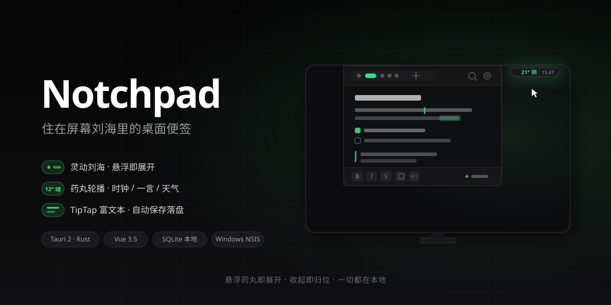
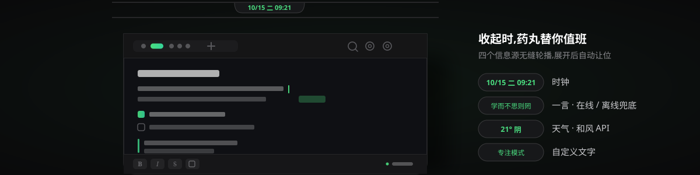

<div align="center">

# Notchpad

**一款住在屏幕刘海里的桌面便签**

Tauri 2 + Rust + Vue 3 + TipTap

[](https://github.com/TIUCSIB/notchpad/releases)
[](LICENSE)
[](https://tauri.app/)
[](https://vuejs.org/)
[](https://www.typescriptlang.org/)

[下载安装包](https://github.com/TIUCSIB/notchpad/releases) · [功能总览](#-功能总览) · [快速开始](#-快速开始) · [项目主页](https://tiucsib.github.io/notchpad/)

</div>

---

紧贴屏幕顶部的轻量便签：平时收成刘海下的一颗小药丸，悬浮或点击即展开，随时记下念头，写完自动恢复。四套主题、面板壁纸、斜杠菜单与全局字体都由你决定，所有数据都在本地。

## 目录

- [它长什么样](#-它长什么样)
- [功能总览](#-功能总览)
  - [交互](#交互)
  - [记录](#记录)
  - [组织](#组织)
  - [外观](#外观)
  - [数据与安全](#数据与安全)
  - [系统整合](#系统整合)
- [药丸信息源](#-药丸信息源)
- [快捷键速查](#-快捷键速查)
- [技术栈](#-技术栈)
- [快速开始](#-快速开始)
- [项目结构](#-项目结构)
- [License](#-license)

---

## 它长什么样

应用启动后自动收起为屏幕顶部中央的小药丸（顶部齐平、底部圆润），悬浮或点击即可展开完整编辑区，收起时带弹性弹簧动画。收起状态下药丸还能轮播时钟、一言、天气或自定义文字——不打开也能瞥一眼有用信息。



---

## 功能总览

### 交互

- **两种唤醒**：悬浮经过药丸自动展开；点击唤醒则在点击时展开，带 Jelly 弹跳动效。可在设置中切换。
- **全局快捷键**：`Ctrl+Alt+Z` 随时呼出窗口并展开。
- **多显示器**：窗口可在多个显示器间切换，选择自动持久化。
- **单实例与托盘**：二次启动唤起已有窗口；关闭后驻留系统托盘，双击恢复。

### 记录

基于 [TipTap](https://tiptap.dev/) 的编辑器，该有的格式都有：

| 能力 | 说明 |
| --- | --- |
| 文本格式 | 加粗、斜体、删除线、行内代码 |
| 结构化 | 引用块、有序/无序列表、任务列表 |
| 链接 | 插入链接，左键/右键直接在系统浏览器打开 |
| 图片 | 截图直接粘贴，自动压缩（最长边 1920px，JPEG 质量 0.8） |
| 字体 | 字体族、字号 12–32px、颜色、高亮 |
| 斜杠菜单 | 输入 `/` 唤出块菜单，支持中英文/拼音关键词筛选，↑↓ 选择、回车插入、Esc 关闭，代码块内不触发 |
| 其他 | 分割线、实时字数统计 |

选中文字后底部会浮出格式菜单，字号/字体/字色/底色就近可取，不必把手移到底栏。

### 组织

- **多页面**：默认上限 10 页，可在 3–30 之间调整；顶部胶囊标签切换，拖拽排序、双击改名、悬浮显示标题。
- **置顶**：页面可置顶/取消置顶。
- **跨页搜索**：`Ctrl+F` 唤起搜索面板，按标题/正文匹配所有页面。
- **回收站**：删除的页面保留 24 小时，错过 5 秒撤销也能一键恢复。

### 外观

外观是这一版的重点，从配色到材质都可以调：

| 项目 | 说明 |
| --- | --- |
| 主题风格包 | **四套**：默认（暖白极简）、护眼（绿豆沙低刺激）、暖纸（米黄低蓝光）、水墨（宣纸宋体）。每套都含浅色与深色调色板。水墨额外带宋体标题、SVG 纸纹与 h1 朱砂短线。 |
| 明暗模式 | 深色 / 浅色 / 跟随系统，独立风格包与明暗两层组合。 |
| 强调色 | **13 种**：7 种基础色 + 各风格包的推荐色，切换风格时自动套用推荐色，之后仍可单独换。 |
| 面板壁纸 | 上传图片后压缩至最长边 2560px，自动采样亮度判断明暗。整块面板铺满壁纸，可分别调**内容区透明度**（0–100%）、**内容卡毛玻璃**（0–20px）、**遮罩浓度**（0–80%）、**壁纸模糊**（0–12px）与**文字色**（自动跟随壁纸明暗 / 强制浅 / 强制深）。 |
| 全局默认字体 | 从**枚举出的本机系统字体**中挑选，作用于整个界面与笔记正文；留空即跟随系统。设了具体字体时标题一并切换，留空时水墨主题仍保留宋体标题。 |

### 数据与安全

- **本地存储**：SQLite（rusqlite 原生绑定）即时落盘，默认在 `%APPDATA%/notchpad/memo.db`。
- **附件**：粘贴的图片以文件形式存放在数据库旁的 `attachments/`，不拖累数据库体积；设置里可**清理未引用附件**。
- **自定义位置**：可把数据库连同图片迁移到其他目录，路径不可达时自动回落并提示。
- **导入导出**：JSON 完整备份导入/导出，Markdown 导出。
- **自动保存**：编辑后自动保存，底部显示"保存中/已保存"状态，也可用 `Ctrl+S` 手动保存。

### 系统整合

- **应用内更新**：设置页一键检查，发现新版本自动下载并重启升级（更新包经 minisign 签名校验）。
- **开机自启**：一键开关。

---

## 药丸信息源

收起状态下，药丸在四个信息源之间轮播，展开后自动让位给编辑器：

| 来源 | 内容 | 说明 |
| --- | --- | --- |
| 时钟 | `10/15 二 09:21` | 月日 + 星期单字 + 时间 |
| 一言 | 每次一句 | [hitokoto](https://hitokoto.cn/) 在线 API，可按分类筛选；离线自动兜底为本地语录 |
| 天气 | `21° 阴` | [和风天气](https://dev.qweather.com/)，填入开发者 Key 与城市名即可，支持自定义 API Host |
| 自定义 | 任意文字 | 设置里自己填 |

一言更新频率可调（5 分钟 ~ 每天 / 每次收起时），天气可调（30 分钟 ~ 每天）；两者仅在药丸来源里启用时才联网拉取，失败静默回落，不影响其他轮播项。

---

## 快捷键速查

| 快捷键 | 功能 | 快捷键 | 功能 |
| --- | --- | --- | --- |
| `Ctrl+N` | 新建页面 | `Ctrl+Z` | 撤销 |
| `Ctrl+D` | 删除页面 | `Ctrl+Y` | 重做 |
| `Ctrl+S` | 保存 | `Ctrl+W` | 最小化到托盘 |
| `Ctrl+F` | 跨页搜索 | `Ctrl+Shift+M` | 切换显示器 |
| `Ctrl+Tab` | 下一页 | `Ctrl+Shift+Tab` | 上一页 |
| `Ctrl+1~9` | 跳转页面 | `Ctrl+Alt+Z` | 全局呼出窗口 |

---

## 技术栈

| 类别 | 技术 |
| --- | --- |
| 框架 | Tauri 2 (Rust 后端) + Vue 3.5 |
| 构建 | Vite + Tauri 2 CLI |
| 编辑器 | TipTap 3 (StarterKit + FontFamily / FontSize / 斜杠菜单等扩展) |
| 动画 | motion-v（弹性物理动画） |
| 图标 | Lucide Vue Next |
| 数据库 | rusqlite（原生 SQLite） |
| 图片处理 | Canvas 压缩（前端）/ 文件系统附件 |
| 字体枚举 | Windows GDI `EnumFontFamiliesEx`（Rust） |
| 测试 | Vitest + jsdom（前端）/ cargo test（Rust 集成测试） |
| 语言 | TypeScript |
| 包管理 | pnpm |

---

## 快速开始

### 环境要求

- Node.js >= 18
- pnpm >= 8
- Rust（MSVC 工具链，Windows）

### 安装与运行

```bash
# 克隆仓库
git clone https://github.com/TIUCSIB/notchpad.git
cd notchpad

# 安装依赖
pnpm install

# 开发模式
pnpm tauri:dev

# 构建 Windows 安装包
pnpm tauri:build
```

不想自己构建？直接到 [Releases](https://github.com/TIUCSIB/notchpad/releases) 下载 NSIS 安装包。

常用校验命令：

```bash
pnpm typecheck   # Vue / TS 类型检查
pnpm test        # Vitest 单元测试
pnpm lint        # ESLint
cd src-tauri && cargo test   # Rust 集成测试
```

---

## 项目结构

<details>
<summary><strong>展开查看</strong></summary>

```
src-tauri/                        # Tauri 2 Rust 后端
├── src/
│   ├── main.rs                   # 应用组装（托盘/快捷键/单实例/协议/启动读设置）
│   ├── db.rs                     # rusqlite 数据库与命令
│   ├── attachments.rs            # 图片附件、自定义协议、孤儿附件清理
│   ├── fonts.rs                  # Windows GDI 系统字体枚举
│   └── notch.rs                  # 刘海状态机与光标轮询
├── tests/                        # Rust 集成测试（附件清理 / 字体名规范化）
└── tauri.conf.json               # 窗口/打包/更新器/CSP 配置

src/renderer/                     # 前端（通过 window.api 桥接 Rust）
└── src/
    ├── App.vue                   # 主组件与面板/壁纸层
    ├── api/bridge.ts             # window.api 兼容桥（Tauri invoke）
    ├── themes.ts                 # 四套主题风格包与 CSS 变量生成
    ├── App.css / editor.css      # 面板与编辑器样式
    ├── components/               # TopToolbar / BottomBar / SelectionMenu / SearchPanel /
    │                             # Settings / SlashMenu / LinkDialog
    ├── composables/              # useNotch / usePages / useSave / useSettings / usePillContent /
    │                             # usePillFeeds / useEditorSetup / useDragReorder / useFontPopups
    ├── extensions/               # fontSize.ts（字号 Mark）/ slashMenu.ts（斜杠菜单扩展）
    ├── utils/                    # dataConverter / pageTitle / wallpaper / fonts
    ├── directives/jelly.ts       # Jelly 弹跳动画指令
    └── __tests__/                # Vitest 单元测试

docs/index.html                   # GitHub Pages 项目主页（单文件静态页）
.github/                          # Banner 与药丸示意图、CI workflow
```

</details>

---

## License

[MIT](LICENSE)
